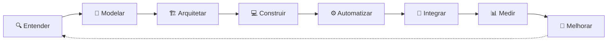

  

  

  
  
  

Conecto <b>negócio, processos, dados, software e IA</b> para transformar operação manual em sistemas completos, do problema até a operação medida.

---

## 🧭 Como eu trabalho

Antes de implementar, pergunto: **este processo deveria mesmo funcionar assim?** De onde vem o dado, quem depende dele, como medir e o que acontece quando falhar.

> 💡 *Registrar o dado uma vez e reutilizá-lo em todo processo.*
> 💡 *Usar o modelo de IA mais barato capaz de resolver a tarefa corretamente.*

---

## 🧩 O que eu faço

| | Área | Na prática |
|:-:|---|---|
| 🏗️ | **Arquitetura de soluções** | System design, sistemas modulares e orientados a eventos, responsabilidades entre serviços, segurança e observabilidade desde o início |
| ⚙️ | **Automação de processos** | Evento → regra → integração → ação → registro → monitoramento, com Power Automate, automações monday.com, webhooks e Typebot |
| 🔌 | **APIs e integrações** | REST, GraphQL, webhooks, OAuth, Microsoft Graph e Entra ID. Diagnóstico de 400/403, autenticação, paginação e permissões |
| 🤖 | **Engenharia de IA** | LLMs, RAG, agentes especialistas e supervisores, roteamento de tarefas, guardrails, IA local com Ollama/Qwen |
| 📊 | **Dados e indicadores** | Modelagem de dados, KPIs, SLAs, NPS, previsto x realizado. Power BI, Power Query, Looker e dashboards monday |
| 🟣 | **monday.com** | A plataforma como sistema operacional da empresa: apps com SDK e React, GraphQL, Canvas, storage, permissões e workflows |
| 👥 | **Liderança técnica** | Padrões, governança, auditoria e documentação. Scrum, Kanban, PDCA, DMAIC, Six Sigma e OKRs |

---

## 🚀 Em destaque

### 🧠 Harness de engenharia assistida por IA
Ambiente próprio de desenvolvimento com IA, montado em cima do **Claude Code**: squads de agentes especialistas sob um supervisor, skills, hooks e **gates de qualidade**, spec antes do código, ADRs, **grafo de conhecimento**, memória de projetos, telemetria e um **painel Electron** para acompanhar e aprovar o trabalho em tempo real. O roteamento manda cada tarefa para a **IA local** ou para a externa, conforme custo e complexidade.

### 🟣 Apps e sistemas no monday.com
Apps de timesheet e relatórios, velocímetro de entregas, planejamento com IA, gestão de usuários e resumo automático de itens. CRM completo com **score de leads por IA**, widgets em React e agentes que abrem cards e atualizam colunas.

### 🔌 Integrações empresariais
**SAP Business One, Bling, Mercado Livre, Microsoft 365/Graph, Gmail, WVetro, Firebase** e **Autodesk**, com uma API que liga o PWS ao CRM.

---

## 📈 Resultados

| | |
|:-:|---|
| ⏱️ | **−80%** no tempo de resposta · **+20%** de retenção nas renovações · **+15%** em novas licenças (pré-vendas Autodesk) |
| ⭐ | NPS **78,35** · nota média **9,5** · **−90%** de escalonamento · **100%** das entregas no prazo · equipe de **12** pessoas |
| 💰 | **−35%** no custo das plataformas de atendimento · técnico novo operando em **2 meses** |
| 🏆 | **Vencedor da Maratona de Inovação (EMTU/SPP)** |

---

## 🛠️ Stack

  
   
  

  
  
  
  
  
  
   
  
  
  
  
  
  

---

## 🎓 Formação

- 🎓 MBA em Arquitetura de Soluções: Aplicações Inteligentes Estratégicas, **PUCPR** *(em andamento)*
- 💻 Engenharia de Computação, **Descomplica**
- ⚙️ Tecnólogo em Engenharia Mecânica, **SENAI SP**
- 🛠️ Base em mecânica de precisão, CAD (SolidWorks, Fusion 360) e manufatura aditiva

🌎 Português (nativo) · Inglês (profissional) · Chinês (básico)

---

## 📊 Estatísticas

  
  

  

  

  

  

---

<b>Negócio + Processos + Software + Automação + Dados + IA + Infraestrutura</b> 
Aberto a projetos de arquitetura de soluções, automação e IA aplicada. Me chama no LinkedIn. 🤝

  

